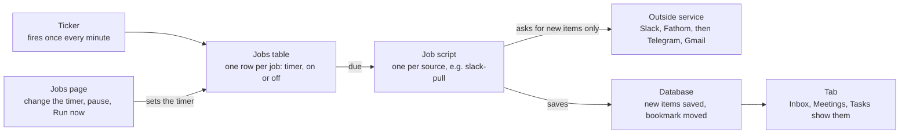

# Command Center: build plan

7 Oct 2026. Shareable version: https://claude.ai/code/artifact/8d45656e-5d15-4b39-a3aa-2683c380e772

The Command Center is a new project, separate from the SPM tracker: its own repository and its own Supabase project. Every pull of outside data (Slack, calls, later Telegram and email) is a named job with its own timer, set from the portal. Phase 1 is Slack and Fathom calls feeding the inbox, tasks and delegation; everything else is Phase 2.

The asks to other people are in [ask-jeremy-credentials.md](ask-jeremy-credentials.md) and [ask-jaap-repo-supabase.md](ask-jaap-repo-supabase.md). The facts behind the limits are in [research-findings.md](research-findings.md).

## How it runs

Every job is a row in a jobs table with its own timer. One ticker fires each minute, runs the jobs that are due and records the result. That is what lets a timer be changed from the portal: a schedule written into the hosting config (Vercel's `vercel.json`) changes only with a new deployment.

A change on the Jobs page applies from the next tick. If a service answers with a wait time, the job stops and its next run moves back by that long.

The Jobs page sits under Settings. For each job it shows on or off, the timer, Run now, the last run, items pulled, the last error and the next run. Each job has a lowest allowed timer, so it cannot be set fast enough to hit a limit. The ticker itself is one scheduled call from Supabase Cron, which can make an HTTP request on a schedule, or from the host.

## One job per tab

Each tab is fed by its own job, and each job is one script with one timer. A tab with no outside data has no job: it reads what the other jobs stored.

| Tab | Job | What the script does | Default timer | Phase |
| --- | --- | --- | --- | --- |
| Inbox | `slack-pull` | Reads new messages in Jeremy's DMs and chosen channels since the last run | 60 min | 1 |
| Inbox | `inbox-triage` | AI sets a priority and drafts a suggested reply for each new message | After each pull | 1 |
| Inbox | `outbox-retry` | Replies and delegation messages are sent on click; this job re-sends any that failed | 1 min | 1 |
| Inbox | `telegram-pull` | Reads new messages in his chosen Telegram chats | 60 min | 2 |
| Inbox | `gmail-pull` | Reads new email since the last run | 60 min | 2 |
| Meetings | `fathom-pull` | Reads new calls with their summary and transcript | 60 min | 1 |
| Meetings, Today | `calendar-pull` | Reads today's and upcoming events | 30 min | 2 |
| Tasks | `task-suggest` | AI reads new messages and transcripts and proposes tasks with a priority and due date | 60 min | 1 |
| Payments | `invoice-detect` | AI finds invoices and unpaid receipts in email and Slack | 60 min | 2 |
| Targets | `kpi-pull`, one per source | Reads each KPI's number from its source | Daily | 2 |
| Settings | `slack-directory-sync` | Refreshes the channel list and team members' Slack ids | Daily | 1 |
| Departments | None | Reads the Tasks data | No timer | 1 |
| Today | None | Reads the other tabs' data; focus and quick links are typed in | No timer | 1 |

In Phase 1, Targets has no job: Jeremy sets the targets and logs the day's numbers by hand.

## Rate limits and the safe timer

An hourly pull uses a small fraction of every limit below. Each job also keeps a bookmark of the last item it saw, so a run asks only for what is new and never re-reads the history.

| Service | Published limit | How the job stays under it | Lowest timer we allow |
| --- | --- | --- | --- |
| Slack | Reading history: 50+ requests a minute. Posting: 1 message a second per channel. Over the limit, Slack answers 429 with a wait time | One request per conversation per run, at most 50 a minute, only messages after the last one seen; waits the stated time on a 429 | 5 min |
| Fathom | 60 calls per 60 seconds; 30 per 60 seconds for transcripts and summaries, which Fathom may lower to 5 | Lists only calls created since the last run and fetches transcripts one at a time | 15 min |
| Gmail, Phase 2 | 6,000 quota units a minute per user. Reading one message costs 20, listing changes 2, sending 100 | Asks only for changes since the last run; 100 new emails cost about 2,000 units | 5 min |
| Telegram, Phase 2 | No published numbers. Over the limit, Telegram answers FLOOD_WAIT with the seconds to wait | Read-only, chosen chats only, one request at a time; waits the stated seconds | 30 min |

Two conditions come with these numbers:

- **Slack.** The 50 a minute holds for an app built inside SPM's own workspace. An app distributed outside the Slack Marketplace is held to 1 history request a minute and 15 messages per request.
- **Telegram.** Accounts that log in through an unofficial client are put under observation, and flooding or spamming gets an account banned. The job only reads, slowly.

## Phase 1: Slack and calls

Phase 1 delivers what Jeremy named as his top priority: Slack and call transcripts feeding an inbox and a task list with due dates and delegation. Anything not connected stays hidden, as Jaap asked.

Build order:

1. Project setup: repository, Supabase project, hosting, a login for Jeremy. Every record carries its owner, so more people can be added later without a rebuild.
2. The jobs engine and the Jobs page: timer, on or off, Run now, run log.
3. Connect Slack as Jeremy, `slack-pull`, and the Inbox tab: conversations by priority, thread view, reply as Jeremy, mark done, make task.
4. Connect Fathom, `fathom-pull`, and the Meetings tab: notes, transcript, tasks from each call.
5. `task-suggest` and the Tasks tab: suggested tasks to add or dismiss, manual tasks, priority, due date, done.
6. Delegation: pick a person, write a note, the person gets a Slack DM from Jeremy; take back. The Departments tab and the team list in Settings.
7. `inbox-triage`: a priority on each message and a suggested reply Jeremy can edit and send.
8. The Today tab (focus, quick links, needs a reply, due today) and Targets with a manual daily log.

Hidden in Phase 1: Telegram, WhatsApp, iMessage, email, Payments, the calendar schedule, upcoming meetings and the Personal side.

## Phase 2

In the order we suggest:

1. Telegram, read from Jeremy's own account. He called it "pretty important".
2. Email and calendar: inbox, reply, today's schedule, upcoming meetings.
3. Payments: invoices found in email and Slack, plus a manual list with repeats.
4. KPIs read from their sources.
5. The same view for more team members, each with their own connections; recurring tasks.
6. WhatsApp, only if his number is on the WhatsApp Business app. Meta connects Business app numbers only, and group chats are not synced.
7. The Personal side (Health, Goals, Habits), if Jeremy wants it.

## What we do on our end

- [ ] Get Jaap's answers: repository, Supabase, hosting, AI key
- [ ] Create the repository and the project skeleton. Proposed stack is the one the tracker uses: Next.js, Supabase, Vercel
- [ ] Database tables: users, connections, jobs, job runs, messages, meetings, tasks, suggestions, team, targets, outbox
- [ ] Store every token encrypted, with the encryption key kept outside the database
- [ ] Build the jobs engine and the Jobs page before any integration
- [ ] Write the Slack app manifest and send it to Jeremy with the steps
- [ ] Build Slack, then Fathom, then tasks and delegation, in the Phase 1 order
- [ ] Test the Telegram login on our hosting before Phase 2 is promised
- [ ] Agree with Jeremy how long message text is kept

## Not proven yet

- **Telegram on our hosting.** Logging in as a user account from short-lived server functions is untested. If it fails, Telegram needs one small always-on worker.
- **Slack app approval.** We do not know whether SPM's workspace requires an admin to approve new apps, or whether Jeremy is an admin.
- **Mentions outside the chosen channels.** Catching these needs Slack search, which is not tested.
- **Fathom coverage.** On the tracker's Fathom integration a key reads only that user's calls and calls shared with them. We do not know that all of Jeremy's calls sit in his own account.
- **Email provider.** The Google route assumes his mailbox is Google Workspace. Microsoft is not researched.
- **AI cost.** Unknown until we see a real day of messages.
